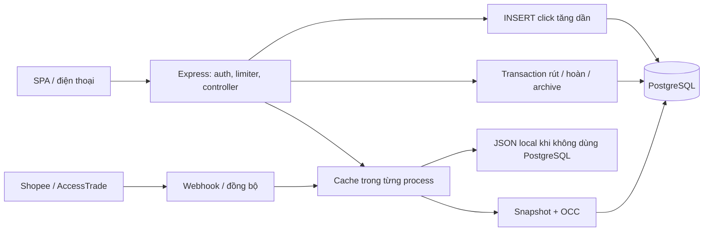

# FINAL PROJECT AUDIT — Cashback / LiLa

**Cập nhật sau kiểm toán:** C01, H01 và C02 đã được sửa trong working tree và kiểm thử riêng ở đợt 1; xem [báo cáo khắc phục](withdrawal-blockers-fix-2026-11-16.md). Nội dung dưới đây giữ nguyên bằng chứng tại thời điểm audit, không mô tả lại ba lỗi đó là còn nguyên sau đợt sửa.

Ngày: 2026-11-16. Đánh giá working tree hiện tại, không giả định các sửa đổi trước đã đúng. Không sửa mã ứng dụng, database production hoặc quy tắc kinh doanh trong lượt kiểm toán này. Chỉ thêm harness chẩn đoán và bằng chứng kiểm thử. Dữ liệu dùng trong trình duyệt và PostgreSQL đều là fixture.

## A. Tổng quan

**NO-GO cho việc xác nhận sẵn sàng vận hành rút tiền thật.** Đã tái hiện một lần bấm gửi + một lần xác nhận tạo hai lệnh rút khác ID và khác khóa idempotency. Ngoài ra có chênh lệch số dư cache/sổ cái khi đổi chủ đơn, lỗi tài khoản giữa instance, và đường logout không xử lý rejection.

Các transaction rút tiền, hoàn tiền, archive và rollback audit đã qua các ca kiểm thử hiện có, nhưng điều đó không bảo đảm toàn bộ luồng người dùng. Database chống lặp cùng key không chống được frontend tạo hai key cho cùng một ý định.

Cấu trúc: Express 4, Node.js, pg/PostgreSQL hoặc JSON local, SPA JavaScript/CSS thuần, service worker offline, API Shopee/AccessTrade/TikTok. Controller và dbService chứa phần lớn nghiệp vụ; PostgreSQL và cache/snapshot cùng tham gia xử lý trạng thái.



Phạm vi bằng chứng: inventory 51 file JS/CSS/HTML/JSON dưới source, public, tests, scripts, api và server; kiểm tra cú pháp 47 file JavaScript. Rà soát sâu các đường tài chính, auth, lưu trữ, resolver/provider, controller, frontend và cấu hình triển khai. Đây không phải chứng nhận rằng mọi dòng mã, mọi tổ hợp trạng thái hay mọi nội dung provider đều đã được kiểm chứng. Các mục chưa đủ môi trường được ghi NOT TESTED, không suy ra PASS từ tên suite hoặc việc chưa thấy lỗi.

## B. Kết quả kiểm tra

| Hạng mục | Kết quả | Bằng chứng / giới hạn |
|---|---|---|
| Cú pháp JavaScript | PASS | 47 file, `node --check`, không lỗi |
| Bộ regression hiện có | PASS | 21/21 suite, 6,83 giây; có suite chỉ kiểm tra chuỗi source |
| 19 ca PostgreSQL hiện có | PASS | Chạy lại trong harness chẩn đoán, database riêng tự tạo/xóa |
| Luồng rút tiền từ UI | FAIL | Hai yêu cầu cho một thao tác; rút lần đầu thiếu ô mật khẩu |
| Đối soát số dư / đổi chủ đơn | FAIL | Cache 6.300đ, ledger 0đ, reload 0đ |
| Tách giao dịch giữa các sàn | FAIL | Cùng mã đơn bị gộp |
| Auth nhiều instance và logout lỗi | FAIL | 200/401 giữa hai worker; logout timeout/unhandled rejection |
| Phân quyền / CSRF mẫu | PASS | Không đăng nhập /me: 401; user gọi admin: 403; Origin lạ với cookie: 403 |
| XSS mẫu tên người dùng | PASS | Payload img/onerror hiển thị dạng text, không thực thi |
| Bảo mật toàn bộ hệ thống | FAIL | Script phá dữ liệu; trạng thái khóa/login chưa nhất quán; chưa pentest toàn diện |
| Dependencies đã cài | PASS | npm audit --omit=dev: 0 advisory được báo ở thời điểm chạy |
| Responsive các màn hình đã duyệt | FAIL | Không tràn ngang root ở 6 kích thước, nhưng toast bị cắt và target nhỏ |
| Offline navigation | PASS | Service worker hiển thị trang ngoại tuyến trong Edge thử nghiệm |
| Tải local redirect / convert | PASS | Đạt các ca fixture, xem H; không phải SLO production |
| Lint / type checking / build | NOT TESTED | Không có script/config tương ứng trong package.json; syntax không thay thế lint |
| Provider thật / thanh toán thật / Redis production | NOT TESTED | Không dùng thông tin xác thực hoặc phát sinh giao dịch thật |
| Backup restore / PITR / failover | NOT TESTED | Chưa có diễn tập khôi phục |
| Safari/iOS, Android thiết bị thật, mạng di động, CLS/LCP production | NOT TESTED | Chỉ Edge headless và viewport giả lập |

## C. Lỗi còn tồn tại

Tất cả mục dưới đây **chưa sửa trong lượt audit**. Với thay đổi API/database/logic tiền/quy trình rút, cần phê duyệt theo yêu cầu kiểm toán mới của người dùng.

### C01 — CRITICAL: Một thao tác tạo hai lệnh rút

- Vị trí: `public/app.js:862`, `public/app.js:1803`, `public/app.js:1846`; `public/index.html:548`.
- Nguyên nhân: nút là `type=submit`, có click handler; submit của form lại gọi `.click()`. Cả hai handler chờ cùng modal, rồi tạo key riêng. Khóa nút chỉ được đặt sau khi xác nhận.
- Tái hiện: tài khoản fixture có 200.000đ và ngân hàng đã lưu; nhập 50.000đ, bấm gửi một lần, xác nhận một lần. Hai HTTP 200, hai ID, hai key. Đã chạy cả trường hợp mất phản hồi đầu tiên và mạng bình thường. Ở lượt mạng bình thường, số lệnh tăng từ 2 lên 4 và số dư từ 100.000đ xuống 0đ.
- Tác động: giữ tiền/rút hai lần ngoài ý muốn. Không phải bằng chứng hai chuyển khoản ngân hàng đã xảy ra; lệnh rút là cơ sở cho quản trị chi trả.
- Sửa đề xuất: một handler submit duy nhất, khóa toàn luồng từ trước modal, một idempotency key bền vững cho một ý định; giữ key khi timeout/reload và đối chiếu kết quả trước retry.
- Bằng chứng: `final-audit/duplicate-normal.json`, `duplicate-withdraw.json`. Trạng thái: tái hiện runtime, chờ phê duyệt.

### C02 — CRITICAL: Script dọn dữ liệu có thể xóa toàn bộ tài chính

- Vị trí: `scripts/clean_test_data.js:1`, `:14`, `:27`, `:32`, `:40`, `:42`, `:51`.
- Nguyên nhân: require server nạp cấu hình môi trường; kết nối DATABASE_URL/POSTGRES_URL, DELETE tất cả orders/withdrawals/ledger, tắt trigger ledger, chỉ giữ năm ID người dùng cố định và đặt số dư về 0.
- Điều kiện: người có quyền chạy script trên máy chứa cấu hình database thật. Không phải endpoint công khai.
- Tác động: mất lịch sử tiền và tài khoản. Script còn exit 0 cả khi catch lỗi.
- Sửa đề xuất: vô hiệu hóa entrypoint này, chỉ cho phép xóa database fixture do harness tự tạo; không dùng allowlist ID cứng để đoán dữ liệu thật. Nếu đã từng chạy, cần kiểm tra log/backup.
- Trạng thái: xác nhận tĩnh, **không thực thi script phá dữ liệu**, chờ phê duyệt. Việc đổi endpoint cleanup sang preview trước đây không xử lý script riêng này.

### H01 — HIGH: Rút lần đầu không có cách nhập mật khẩu bắt buộc

- Vị trí: `public/app.js:1276`; `src/services/cashbackController.js:1314`.
- Nguyên nhân: frontend chỉ hiện password khi đã có savedAcc và đổi số tài khoản; backend yêu cầu cả khi chưa có savedAcc.
- Tái hiện: tài khoản chưa lưu ngân hàng, nhập ngân hàng/STK/tên/số tiền hợp lệ. Ô password ẩn, API 403. Hai lần thử tạo bốn request do C01, tất cả bị từ chối, số dư không đổi.
- Tác động: khách mới không rút được qua UI thông thường.
- Sửa: đồng nhất điều kiện yêu cầu password, thông báo và validation. Không giảm yêu cầu bảo vệ tài khoản ở backend.
- Trạng thái: runtime; `final-audit/first-withdrawal.json`; chờ phê duyệt luồng rút.

### H02 — HIGH: Tài khoản mới không sử dụng nhất quán giữa instance

- Vị trí: `cashbackController.js:154`, `:761`, `:858`; cache trong dbService.
- Nguyên nhân: middleware đọc role/token_version từ SQL nhưng getAuthUser vẫn yêu cầu user tồn tại trong cache của process; login cũng tìm user trong cache.
- Tái hiện: hai worker dùng chung DB và JWT secret. Đăng ký ở A; cùng token gọi /me: A=200, B=401 cho tới khi B reload.
- Tác động: bị đăng xuất/không đăng nhập ngẫu nhiên khi scale hoặc serverless nhiều instance.
- Sửa: đọc hồ sơ auth đầy đủ từ nguồn authoritative hoặc có cơ chế invalidation/reload có version; kiểm thử register/reset-password/lock trên hai worker.
- Trạng thái: runtime, diagnostics.json; cần phê duyệt thay đổi auth/data access.

### H03 — HIGH: Chuyển chủ đơn làm sai số dư hiển thị và thiếu credit người nhận

- Vị trí: `dbService.js:1945`, `:2042`, `:2054`; `cashbackController.js:2267`.
- Nguyên nhân: ref `order_credit_<orderSn>` là toàn cục. Khi chủ mới cần credit, appendLedgerEntry trả entry cũ của chủ trước; reconciler đưa entry đó vào tổng của chủ mới.
- Tái hiện: đơn approved cashback 6.300đ của A đã lưu; chuyển userId/code sang B rồi recalculateAllWallets. B hiển thị 6.300đ nhưng ledger của B=0; save/reload về 0.
- Tác động: mất tính đúng đắn khi quản trị chuyển chủ đơn. Kiểm tra số dư SQL ở bước rút hạn chế rút vượt ledger, không sửa được credit thiếu.
- Sửa: thiết kế bút toán chuyển quyền gồm revoke A/credit B trong cùng transaction, ref chứa định danh nghiệp vụ phù hợp; không tái sử dụng entry khác user.
- Trạng thái: runtime, diagnostics.json; chờ phê duyệt logic tiền.

### H04 — HIGH: Trùng mã đơn giữa Shopee/TikTok ghi đè giao dịch

- Vị trí: `dbService.js:767`, `cashbackController.js:246` và các truy vấn theo orderSn.
- Nguyên nhân: khóa chính và lookup chỉ dùng order_sn, không có namespace platform/network.
- Tái hiện: upsert Shopee SAME_PLATFORM_ID commission 10.000, rồi TikTok cùng ID commission 20.000. Còn một đơn platform Shopee, commission 20.000.
- Tác động: sai hoa hồng, chủ giao dịch và đối soát nếu hai nguồn có ID trùng. Chưa xác định tần suất thực tế từ provider.
- Sửa: khóa định danh theo nguồn/sàn + mã; lập migration cả order references/ledger/import/webhook, đối soát dữ liệu cũ trước triển khai.
- Trạng thái: runtime, diagnostics.json; cần phê duyệt migration.

### H05 — HIGH: Logout lỗi lưu gây request treo / unhandled rejection

- Vị trí: `cashbackController.js:986`.
- Nguyên nhân: async route Express 4 không bọc asyncHandler/try-catch; await saveDb có thể reject STATE_CONFLICT.
- Tái hiện: A thay đổi version, B logout với cache cũ. Client timeout sau 1,2 giây; harness ghi unhandled STATE_CONFLICT. Harness có listener riêng để quan sát và tránh dừng worker; ứng dụng bình thường có thể treo request hoặc dừng process tùy entrypoint/Node config.
- Tác động: logout không được hoàn tất có kiểm soát, session/cookie còn tồn tại hoặc UI tự coi đã logout.
- Sửa: xử lý lỗi route và quyết định rõ logout một thiết bị/hủy token toàn bộ; cập nhật tokenVersion nguyên tử thay snapshot.
- Trạng thái: runtime, diagnostics.json; chờ phê duyệt API/session.

### H06 — HIGH: Đồng bộ báo cáo không duyệt hết trang

- Vị trí: `shopeeService.js:313`; `tiktokService.js:202`; `cashbackController.js:539`.
- Nguyên nhân: Shopee gọi limit 50 một lần; AccessTrade limit 100 một lần, không cursor/page loop. Sau đó cập nhật lastAutoSyncAt.
- Điều kiện: nguồn có nhiều bản ghi hơn một trang hoặc cần cập nhật đơn ở trang sau.
- Tác động: nguy cơ bỏ sót đơn/cập nhật; chưa xác nhận mức thiếu dữ liệu trên tài khoản thật.
- Sửa: kiểm chứng contract chính thức/provider sandbox, duyệt trang với watermark và retry có checkpoint; không chỉ tăng limit.
- Trạng thái: xác nhận cấu trúc mã, **chưa kiểm thử provider thật**; cần phê duyệt thay đổi đồng bộ.

### M01 — MEDIUM: Login vẫn thành công cho tài khoản đã khóa

- Vị trí: `cashbackController.js:939`.
- Nguyên nhân: login kiểm tra mật khẩu nhưng không chặn accountLocked/isDeleted trước trả token/user.
- Tái hiện: admin khóa user; đăng nhập đúng mật khẩu trả 200 kèm user. Các API bảo vệ vẫn có kiểm tra khóa, nên không suy ra user đã vượt quyền rút tiền.
- Tác động: hành vi bảo mật và UI không nhất quán, vẫn trả hồ sơ/số dư trong response login.
- Sửa: kiểm tra trạng thái authoritative trước phát hành session. Trạng thái: runtime, chưa sửa.

### M02 — MEDIUM: API đơn hàng hai chế độ trả khác trạng thái claim

- Vị trí: `postgresRepository.js:89`; `cashbackController.js:2031`.
- Nguyên nhân: mapper SQL preferSql chưa bổ sung các trường claim mới.
- Tái hiện: cùng đơn TEST_CLAIM_REJECTED đã chuyển verified; API bình thường claimVerified=true, preferSql=true không có trường.
- Tác động: client chọn SQL nhận dữ liệu đối soát thiếu/khác nhau.
- Sửa: mapper chung hoặc schema response chung; test parity. Trạng thái: runtime, diagnostics.json, chưa sửa.

### M03 — MEDIUM: Lịch sử ví chỉ lấy 30 bút toán đầu tiên

- Vị trí: `cashbackController.js:1024`; loader ledger sắp created_at ASC, appendLedgerEntry push cuối.
- Điều kiện: tài khoản hơn 30 bút toán.
- Tác động: biến động mới không xuất hiện dù số dư thay đổi.
- Sửa: sắp mới nhất và pagination ổn định, không chỉ slice đầu. Trạng thái: xác nhận tĩnh, chưa chạy ca >30 qua UI.

### M04 — MEDIUM: Toast mobile bị cắt nửa bên trái

- Vị trí: `public/styles.css:2048`, `:2503`.
- Nguyên nhân: rule mobile đầu translateX(-50%); rule sau đổi left/right 14px nhưng không reset transform.
- Tái hiện Edge viewport 360: toast left=-152, right=180, width=332 sau animation. Ảnh wallet/admin thể hiện chữ bị cắt.
- Tác động: không đọc đủ lỗi/xác nhận, đặc biệt nguy hiểm khi thao tác tiền.
- Sửa: thống nhất một quy tắc định vị và animation mobile. Trạng thái: runtime, security-ui.json, chưa sửa.

### M05 — MEDIUM: Một số vùng chạm nhỏ

- Vị trí: `public/styles.css:1577`, `:2478`; `public/index.html:536`.
- Tái hiện: Rút tối đa cao ~15,19px; Sao chép ~22px; Trước/Sau ~23,19px trong Edge với font fallback.
- Nguyên nhân: btn-xs bị loại khỏi quy tắc tăng vùng chạm, kèm padding inline.
- Tác động: khó thao tác chính xác trên điện thoại.
- Sửa: tăng hit area các nút quan trọng, đo lại khi tải font thật. Trạng thái: runtime; chưa kiểm trên thiết bị thật, chưa sửa.

### M06 — MEDIUM: Snapshot/cache chung vẫn là điểm nghẽn và rủi ro đồng thời

- Vị trí: `dbService.js:628`, `:1802`, `:1883`; controller cập nhật đơn/admin balance.
- Nguyên nhân: nhiều nghiệp vụ cùng sửa object cache rồi lưu toàn bộ bảng/snapshot; global state lock và tải toàn bộ history.
- Điều kiện: nhiều thao tác quản trị/webhook/save đồng thời, dữ liệu tài chính lớn.
- Tác động: xung đột, latency/memory tăng; các ca race đã pass chỉ bao phủ một tập lịch xen kẽ.
- Sửa: transaction theo nghiệp vụ, truy vấn/pagination authoritative, test mixed workload. Trạng thái: rủi ro kiến trúc có bằng chứng mã, chưa có soak/mixed workload đầy đủ.

### M07 — MEDIUM: Local JSON không rollback cache khi ghi đĩa lỗi

- Vị trí: `dbService.js:592`, `:628`, `:2471`.
- Nguyên nhân: nhánh phục hồi cache sau save lỗi chỉ áp dụng khi có pgPool; nghiệp vụ đã mutate trước save.
- Điều kiện: hết đĩa/quyền ghi/file rename lỗi ở chế độ JSON.
- Tác động: UI/cache có thể giữ thay đổi chưa bền vững, lần sau lưu ngoài ý muốn.
- Sửa: giới hạn JSON cho phát triển hoặc triển khai snapshot/rollback local được kiểm thử. Trạng thái: xác nhận tĩnh; chưa fault-inject filesystem.

### M08 — MEDIUM: Chống replay webhook phụ thuộc dữ liệu tùy chọn

- Vị trí: `webhookSecurityService.js:verifyWebhookRequest`; `cashbackController.js:1747`, `:1836`.
- Nguyên nhân: timestamp chỉ kiểm nếu được gửi; chưa có inbox lưu event ID. Một số đường ingestion không truyền eventTime.
- Điều kiện: webhook hợp lệ bị gửi lại hoặc đảo thứ tự mà không có timestamp nghiệp vụ.
- Tác động: không thể bảo đảm mọi trạng thái tiền luôn theo sự kiện mới nhất; HMAC/token bảo vệ nguồn gửi nhưng không thay thế thứ tự/idempotency nghiệp vụ.
- Sửa: xác minh contract từng provider, lưu inbox/event identity/watermark trong transaction; không bắt buộc header mới một cách tùy tiện làm hỏng provider.
- Trạng thái: rủi ro tĩnh; chưa tái hiện gian lận tiền end-to-end từ replay.

### L01 — LOW: Preview lỗi bị ẩn mà không giải thích

- Vị trí: `public/app.js:1031`.
- Tái hiện: mock /api/preview trả 500; card bị ẩn, thông báo provider không xuất hiện.
- Tác động: người dùng không biết link không hỗ trợ hay dịch vụ lỗi; chưa thấy crash trong mẫu.
- Sửa: thông báo lỗi nhẹ có retry, phân biệt abort chủ động. Trạng thái: mã + browser probe, chưa sửa.

### L02 — LOW: Khoảng trống kiểm tra tự động và tài liệu vận hành

- Vị trí: package.json, tests/test_manual_checklist_simulation.js, tests/test_mobile_first_and_ux_upgrade.js, README.md.
- Nguyên nhân: chưa có lint/type/build config; một số test tên audit/manual/responsive chỉ kiểm chuỗi source, không chạy browser. README chủ yếu nói chuyển link.
- Tác động: test xanh không phát hiện C01/H01 và không mô tả đủ chuẩn triển khai tài chính.
- Sửa: thêm E2E đường rút tiền/submit/retry/refresh, kiểm thử đa instance và checklist triển khai/khôi phục. Trạng thái: xác nhận tĩnh, chưa sửa.

## D. Lỗi mới phát sinh và regression

- C01 và H01 **đã có trong HEAD**, không quy kết là phát sinh từ lần sửa gần nhất; chúng vẫn lọt qua regression.
- M02 là phần tích hợp còn thiếu sau bổ sung lưu claim: persisted state đã đầy đủ hơn nhưng mapper SQL chưa đồng bộ.
- H05 là đường lỗi cũ không được xử lý, nay OCC có thể chủ động trả STATE_CONFLICT; kiểm thử đã xác nhận kết hợp này gây request treo.
- Các thay đổi hành vi đã chủ ý: hard-delete withdrawal nay archive; cleanup endpoint nay previewOnly; production cần secret/database/Redis cho các route fail-closed. Client/triển khai cũ cần được kiểm tra tương thích; không tự gọi đây là bug.
- Không có snapshot môi trường production trước cải tiến để so sánh mọi hành vi. Git HEAD chỉ là baseline mã đang có, không chứng minh toàn bộ lịch sử phát hành.

## E. Kết quả kiểm thử và khả năng tái lập

Lệnh đã chạy:

```text
npm.cmd test
npm.cmd audit --omit=dev --json
node --check <47 JavaScript files>
$env:PG_TEST_URL='postgresql://audit_admin@127.0.0.1:55439/postgres'
node tests/final-audit-diagnostics.js
$env:CAPACITY_REPORT='C:\NTV\Aff\docs\final-audit\capacity.json'
node tests/load.capacity.js
node <TEMP>/aff-final-audit-tools/ui.cjs
node <TEMP>/aff-final-audit-tools/admin.cjs
node <TEMP>/aff-final-audit-tools/duplicate.cjs
node <TEMP>/aff-final-audit-tools/duplicate-normal.cjs
node <TEMP>/aff-final-audit-tools/security-ui.cjs
```

`final-audit-diagnostics.js` chạy lại 19 kiểm thử PostgreSQL rồi in quan sát lỗi; exit 0 nghĩa harness chạy xong, **không phải các quan sát lỗi đã PASS**. Các kết quả sai được ghi JSON. Dùng shared JWT test secret để việc kiểm tra đa instance không bị nhiễu bởi secret tạm khác nhau.

Playwright được cài riêng dưới TEMP; dùng Edge có sẵn, không thêm dependency ứng dụng. File `repro-*.cjs` là bản sao harness có đường dẫn môi trường cụ thể: cần đổi đường dẫn/cài Playwright vào nơi resolve được trước khi tái chạy. Server browser fixture xóa biến kết nối/secret kế thừa, NODE_ENV=test và database JSON tạm; không dùng database người thật. Các artifact không chứa token đăng nhập thật.

Hai lượt harness UI ban đầu timeout ở bước mở admin vì tên đăng nhập fixture bị bootstrap admin chuẩn hóa lại và điều hướng mobile cần đi qua tab Tôi. Đã điều chỉnh harness và chạy riêng admin thành công; không tính các lượt timeout đó là PASS. Kết quả các màn hình user trước bước admin đã được lưu đầy đủ.

Không chạy scripts/clean_test_data.js, không dùng test live-provider/test_product_features để gọi dịch vụ thật, không deploy. Chưa chạy E2E thanh toán ngân hàng, provider sandbox, Redis production, restore backup hoặc soak nhiều giờ.

## F. Bảo mật

- Đã quan sát chặn unauthorized /me, user truy cập admin, Origin lạ với auth cookie và escaping một payload tên người dùng.
- Password dùng scrypt; token ký HMAC và version; các câu SQL nghiệp vụ chủ yếu parameterized. Resolver có allowlist, chặn IP nội bộ, DNS pinning, giới hạn hop/body và timeout. Đây là đánh giá mã cộng các test hiện có, không khẳng định đã loại trừ mọi SQLi/SSRF/XSS.
- npm audit trả 0 advisory được báo cho 85 dependencies theo metadata. Không đồng nghĩa không có vulnerability logic hoặc zero-day.
- C02, M01, H05 và rủi ro replay còn mở. Chưa xác minh production secrets, quyền SQL thực tế, Redis, CORS/proxy thực tế và lịch sử log có chứa PII. Không in hoặc thay secret thật.

## G. UI/UX

- Edge headless, 360/375/390/412/430/1440px, height 900px; duyệt home, login, orders, wallet, account, guide, terms. 54 bản ghi gồm trạng thái và timing; admin thử riêng 360px.
- Root scrollWidth không vượt viewport ở các mẫu. Login modal đóng sau đăng nhập ở cả sáu kích thước. Chưa kết luận tất cả nội dung dài, mọi modal và mọi breakpoint đều đúng.
- Toast bị cắt và target nhỏ là lỗi đo thực tế, không chỉ suy ra từ ảnh. Luồng rút không đạt dù bố cục không tràn ngang.
- Offline navigation hiển thị trang offline. Tên chứa markup không chạy script trong mẫu kiểm thử.
- External font/request bị chặn trong browser harness để cô lập: typography/font thật, provider image, device keyboard/safe area iOS, screen reader, contrast đầy đủ và LCP/CLS thực chưa kiểm chứng.

## H. Hiệu năng

Đo mới trên localhost PostgreSQL, seed 60.000 click, 20 worker request đồng thời. Provider fixture thêm 100ms; log bị mute; kiểm tra quota thật trước rồi bypass limiter **trong harness** để đo throughput.

| Tải | Kết quả | p95 | p99 |
|---|---|---:|---:|
| 100.000 redirect | 43,13s; 100.000 HTTP 302; 0 sai đích | 16,09ms | 19,05ms |
| 2.000 chuyển link | 11,69s; 2.000 HTTP 200; 2.000 bản ghi mới bền vững | 127,57ms | 149,83ms |
| 20 tài khoản cùng IP, 40 request | 40 thành công | 130,12ms | 161,26ms |
| Một tài khoản thêm 35 request sau hai lần trước | 28 thành công, 7 HTTP 429 | 129,64ms | 129,97ms |

RSS lấy mẫu khoảng 197MB sau chuyển link; **không phải peak memory**, không chứng minh không leak. Không có dữ liệu tài chính lớn trong benchmark; không suy ra throughput withdrawal/admin/sync.

Assets hiện tại: app.js 139.404 bytes, CSS 80.889 bytes, HTML 126.810 bytes; tổng 347.103 bytes trước nén. Gzip tính offline lần lượt 30.880, 14.426, 23.969 bytes; không phải số transfer production. Server local trả app.js không có Content-Encoding. Video hướng dẫn 1.972.425 bytes. Chưa đo mobile network/Core Web Vitals production.

Số trước cải tiến tồn tại trong tài liệu cũ, nhưng không dùng làm phép so sánh A/B có kiểm soát cho lượt audit này. Với mô hình 20 người × 100 link/ngày và 20 người × 5.000 click/ngày, đường click/convert fixture đáp ứng bài đo; đường tài chính vẫn NO-GO.

## I. Đề xuất tiếp theo

1. Chặn phát hành luồng rút tiền hiện tại; phê duyệt sửa C01/H01 và kiểm thử một click/Enter/double-click, timeout sau commit, reload, retry cùng key, hai thiết bị.
2. Vô hiệu hóa script C02; xác minh không có automation/deployment nào gọi nó. Không chạy script để thử trên database thật.
3. Phê duyệt thiết kế transaction chuyển chủ đơn, identity theo nguồn/sàn, auth đa instance và logout nguyên tử; chuẩn bị migration có dry-run/backup/rollback trước khi sửa dữ liệu thật.
4. Hoàn thiện pagination provider dựa trên contract đã xác minh; bổ sung parity response claim và lịch sử ledger mới nhất.
5. Sửa toast/hit area, thêm E2E browser vào gate regression. Sau đó diễn tập backup/restore, kiểm tra production configuration và mixed workload.

## J. Kết luận

Không đủ điều kiện tuyên bố dự án ổn định tài chính hoặc sẵn sàng mở rộng production. Bằng chứng quyết định là một thao tác tạo hai lệnh rút và các bất nhất dữ liệu đã tái hiện, dù 21 suite và 19 ca PostgreSQL cũ đều xanh. Chưa có bằng chứng mất tiền thật; toàn bộ thử nghiệm dùng fixture. Cần sửa các blocker, chạy lại kiểm thử liên quan và kiểm chứng vận hành trước khi đổi kết luận.

Artifact: `docs/final-audit/` chứa JSON, log, ảnh và harness sao chép; `tests/final-audit-diagnostics.js` chứa kiểm thử đa instance tái lập.
